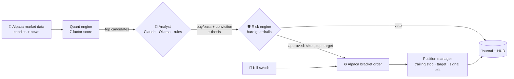
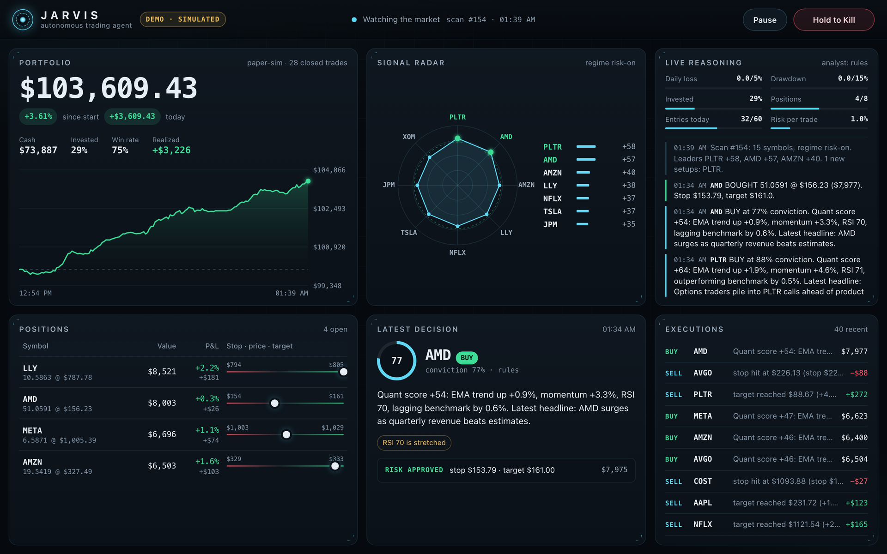

<div align="center">


# JARVIS · Autonomous AI Stock Trading Agent

**An open-source AI trading bot that scans the market, reasons like a portfolio manager, and trades on Alpaca 24/7, inside hard risk limits it cannot break.**

Claude, Claude Code or a local Ollama model writes the thesis. Plain Python code sizes the trade, sets the stop and can veto anything.

[](https://github.com/begad-tamim/jarvis-trading-agent/actions/workflows/ci.yml)
[](https://github.com/begad-tamim/jarvis-trading-agent/actions/workflows/codeql.yml)


[](LICENSE)

[**Quick start**](#-quick-start-30-seconds-no-keys) · [How it works](#-how-it-works) · [Safety](#-safety-the-ai-proposes-the-code-decides) · [Backtest](#-backtesting) · [Config](#-configuration) · [FAQ](#-faq)


<sub>The live HUD in <code>jarvis demo</code> mode (simulated market). Every scan, thesis, veto and order streams in real time.</sub>

</div>

---

## 🧠 The problem

The market moves while you're in a meeting, asleep, or living your life. And when you *do* trade, emotion makes the calls: FOMO entries, no stop-loss, panic exits.

Most "AI trading bots" make this worse. They hand a language model the keys and hope it doesn't hallucinate a position size.

## ⚡ The fix

**JARVIS** is a small, fast, fully local agent that splits the job the way a real trading desk does:

| Role | Who | What it does |
|---|---|---|
| 📡 **Quant** | Python | Scores 20+ liquid stocks on 7 explainable factors, every few minutes |
| 🧠 **Analyst** | Claude / Claude Code / Ollama / rules | Reads the signals and the news, says *buy* or *pass* with a calibrated conviction and a plain-English thesis |
| 🛡️ **Risk manager** | Python | Sizes every trade from volatility, attaches a stop, enforces 10+ hard limits. **Can veto anything.** |
| ⚙️ **Execution** | Alpaca API | Bracket orders, so the stop-loss lives *at the broker*, even if your laptop dies |
| 👁️ **Oversight** | You | A live HUD dashboard, phone alerts, and a press-and-hold kill switch |

> **The AI proposes. The code decides.** The model never chooses a share count, a price, or whether a stop exists.

## 🚀 Quick start (30 seconds, no keys)

```bash
git clone https://github.com/begad-tamim/jarvis-trading-agent
cd jarvis-trading-agent
pip install .            # zero dependencies: stdlib only
jarvis demo              # simulated market + live dashboard opens in your browser
```

That's it: a simulated market, $100k of play money, and JARVIS trading it live in front of you.

### Paper trading on Alpaca (free, real market data)

1. Create a free account at [alpaca.markets](https://app.alpaca.markets/signup) and generate **paper** API keys.
2. Configure and run:

```bash
cp .env.example .env && chmod 600 .env     # paste your Alpaca paper keys
cp examples/jarvis.toml jarvis.toml        # optional: universe, risk, analyst
jarvis doctor                              # checks keys, config and security settings
jarvis run                                 # trades autonomously during market hours
```

### Add the AI analyst

```bash
pip install ".[ai]"                         # official Anthropic SDK (optional)
```

```toml
# jarvis.toml
[jarvis]
analyst = "claude"          # Anthropic API (ANTHROPIC_API_KEY)
# analyst = "claude-code"   # your Claude subscription via the `claude` CLI, no API key
# analyst = "ollama"        # 100% local and private, e.g. analyst_model = "qwen2.5:7b"
```

### Docker

```bash
docker compose up                          # demo, HUD on http://127.0.0.1:8777
JARVIS_CMD=run docker compose up           # paper trading (reads .env)
```

## 🔁 How it works



Every tick: sync the account, enforce halts, manage exits. Every scan: score the universe, ask the analyst, run the risk verdict, execute.
**Exits are managed even when JARVIS is paused or halted.** Protecting open positions never stops.

### The quant score

Seven factors, each normalised to `[-1, 1]`, weighted into a score from `-100` to `+100`. Each factor is reported to the analyst and shown on the dashboard, so every trade is explainable:

| Factor | Weight | Signal |
|---|---:|---|
| Trend | 25 | Fast EMA vs slow EMA |
| Momentum | 20 | Rate of change |
| MACD | 15 | Histogram, ATR-normalised |
| Structure | 10 | Price vs slow SMA |
| RSI | 10 | Rewards 50-70, penalises overbought and falling knives |
| Volume | 10 | Volume surge in the direction of the move |
| Relative strength | 10 | Outperformance vs the benchmark (SPY) |

Plus a **market-regime filter**: when SPY trades below its 50-period EMA, the bar for new buys goes up.

## 🛡️ Safety: the AI proposes, the code decides

| Guardrail | Default | Why |
|---|---|---|
| Risk per trade | 1% of equity | Position size = risk ÷ (2 × ATR). Volatile stocks get smaller positions. |
| Stop-loss | Mandatory, 2×ATR | Sent as a **bracket order**, so it lives at the broker |
| Take-profit | 4×ATR (2:1) | Locks in winners |
| Trailing stop | 2.5×ATR | Ratchets up only, never down |
| Max position | 10% of equity | No single-stock blowups |
| Max positions | 8 | Diversification |
| Margin | **Never** | Buying power capped at cash; exposure ≤ 95% |
| Daily loss halt | -3% | Stops opening trades for the day |
| Drawdown kill switch | -15% from peak | Cancels everything and flattens |
| Entry limit | 20 / day | No over-trading |
| Cooldown | 60 min | No revenge re-entries |
| PDT guard | on | Blocks entries that could trip the US pattern-day-trader rule (<$25k) |
| Liquidity | ≥ $5 price, ≥ $1M daily volume | No penny stocks |
| Conviction | ≥ 0.55 | The analyst must actually believe it, and conviction can only *shrink* a position |
| **Live money** | **Locked** | Needs `mode = "live"` **and** `JARVIS_LIVE_TRADING=I_UNDERSTAND_THE_RISKS` |

LLM output is treated as untrusted. It's parsed against a strict JSON schema, unknown tickers are dropped, and news headlines are fenced as data so prompt injection can't place orders. See [SECURITY.md](SECURITY.md) for the full threat model.

## 🖥️ The dashboard



- **Portfolio**: live equity curve, P&L, win rate, realized gains
- **Signal radar**: the universe ranked by quant score, with buy setups lit
- **Live reasoning**: JARVIS's inner monologue: scans, theses, vetoes and fills
- **Positions**: each one on a stop → price → target ladder
- **Latest decision**: the analyst's thesis, conviction ring, and the risk engine's verdict
- **Kill switch**: press and hold for one second to cancel everything and flatten

Built with zero frameworks and zero third-party requests: one HTML file, one CSS file, one JS file. It binds to `127.0.0.1`, uses a 256-bit access key and a strict Content-Security-Policy, and is mobile responsive.

## 📈 Backtesting

The backtester replays history through **the exact same `Engine`, strategy and risk code that trades live**, so there is no separate backtest logic to drift from reality.

```bash
jarvis backtest NVDA AAPL MSFT AMZN META GOOGL AVGO JPM LLY COST --range 2y
jarvis backtest --demo                     # offline, synthetic data
```

Honest example (daily bars, 10 mega-caps, 2 years to Nov 2026, rules analyst, default risk):

| | JARVIS | SPY buy & hold |
|---|---:|---:|
| Total return | **+8.9%** | +20.6% |
| Max drawdown | **-5.9%** | -19.0% |
| Trades | 100 | 1 |
| Win rate / profit factor | 39% / 1.37 | n/a |

In a strong bull market, a risk-first trend system lags buy-and-hold on return, but it took about a third of the drawdown. That's the trade-off of never risking more than 1% per trade. JARVIS is built to survive, not to promise 10x. Tune it, test it, and judge it on paper first.

> The LLM analyst is deliberately **not** used in backtests: models have read the news after your start date (look-ahead bias).

## ⚙️ Configuration

All strategy and risk settings live in [`examples/jarvis.toml`](examples/jarvis.toml). Secrets live only in `.env` (see [`.env.example`](.env.example)).

<details>
<summary><b>CLI reference</b></summary>

| Command | What it does |
|---|---|
| `jarvis demo` | Simulated market + live HUD. No keys, no network. |
| `jarvis run` | Autonomous trading on Alpaca (paper unless unlocked) |
| `jarvis scan [--demo]` | Rank the universe right now, with reasons |
| `jarvis backtest [SYMBOLS] [--range 2y] [--demo] [--json out.json]` | Replay history through the live engine |
| `jarvis status` | Account, positions, open orders |
| `jarvis doctor [--offline]` | Config, keys and security checks |
| `jarvis kill [--yes]` | Cancel all orders and close all positions |

</details>

<details>
<summary><b>Analyst providers</b></summary>

| Provider | Cost | Privacy | Setup |
|---|---|---|---|
| `rules` | free | 100% local | none (default) |
| `claude` | API usage (~1 call / 15 min) | Anthropic API | `pip install ".[ai]"`, `ANTHROPIC_API_KEY` |
| `claude-code` | your Claude plan | Anthropic | [Claude Code](https://claude.com/claude-code) installed |
| `ollama` | free | 100% local | [Ollama](https://ollama.com) + `ollama pull qwen2.5:7b` |

The default Claude model is `claude-opus-5-5`. Set `analyst_model = "claude-haiku-5-5"` for a much cheaper analyst.

</details>

<details>
<summary><b>Phone alerts</b></summary>

Set any of `TELEGRAM_BOT_TOKEN` + `TELEGRAM_CHAT_ID`, `DISCORD_WEBHOOK_URL` or `SLACK_WEBHOOK_URL` in `.env`. Every buy, sell and kill switch is pushed to your phone.

</details>

## 🗂️ Project structure

```
jarvis/
├── engine.py        # the autonomous loop (scan → think → verify → execute → protect)
├── strategy.py      # 7-factor explainable quant score + regime filter
├── analyst.py       # Claude / Claude Code / Ollama / rules analysts, strict schema
├── risk.py          # the guardrails: sizing, stops, halts, kill switch
├── indicators.py    # EMA, RSI, MACD, ATR, Bollinger… in pure Python
├── backtest.py      # replays history through the live engine
├── brokers/         # alpaca.py (paper/live), paper.py (local simulator)
├── data/            # alpaca_data.py, yahoo.py, synthetic.py
├── server.py        # locked-down dashboard server (token auth, CSP, SSE)
├── journal.py       # SQLite trade journal + audit log
└── web/             # the HUD: index.html, style.css, app.js
```

## ❓ FAQ

**Is this profitable?**
Nobody can promise that, and you should distrust any bot that does. JARVIS gives you a disciplined, explainable, risk-capped process and the tools to test it. Run it on paper for weeks before considering real money.

**Does it trade by itself all day?**
Yes. `jarvis run` scans, decides and trades on its own every market day, manages stops and targets on every tick, and sleeps while the market is closed.

**Which broker and markets?**
US stocks and ETFs on [Alpaca](https://alpaca.markets) (paper and live). The `Broker` interface is about 7 methods, so PRs for other brokers are welcome.

**Do I need an AI API key?**
No. The `rules` analyst is free and offline. `claude-code` uses an existing Claude subscription, and `ollama` runs a local model.

**Is it safe to run on my laptop?**
The dashboard is local-only and token-protected, keys stay in `.env`, and stops live at the broker. Read [SECURITY.md](SECURITY.md).

**Why "JARVIS"?**
It started as a personal AI assistant. The trading desk was the part people kept asking about, so it became its own open-source project.

## 🗺️ Roadmap

- [ ] More brokers (Interactive Brokers, Tradier)
- [ ] Multi-timeframe confirmation (daily trend + intraday entry)
- [ ] Portfolio-level correlation limits
- [ ] Walk-forward optimisation in the backtester
- [ ] Weekly AI performance review report

## 🤝 Contributing

PRs are welcome. Read [CONTRIBUTING.md](CONTRIBUTING.md). The two rules: **zero required dependencies**, and **the LLM never gets the final say on risk.**

If JARVIS is useful or interesting to you, **a ⭐ helps others find it.**

## ⚠️ Disclaimer

This software is for education and research. It is **not financial advice**. Trading stocks involves substantial risk of loss. Past or simulated performance does not guarantee future results. You are solely responsible for any trades placed by software you run. Use paper trading first.

---

<div align="center">

Built by **Begad Tamim**, AI engineer · [GitHub](https://github.com/begad-tamim) · [LinkedIn](https://www.linkedin.com/in/begad-tamim) · MIT License

<sub>AI trading bot · autonomous trading agent · LLM trading agent · Claude trading bot · Alpaca trading bot in Python · algorithmic trading · paper trading · stock market AI · Ollama · JARVIS AI</sub>

</div>
