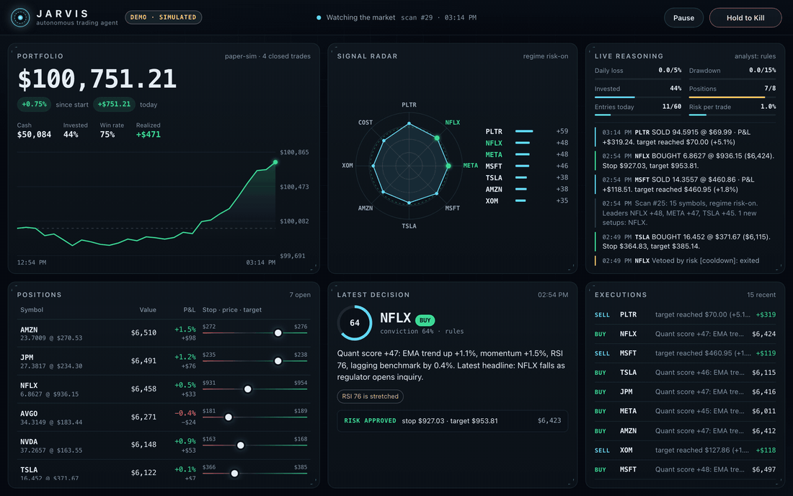
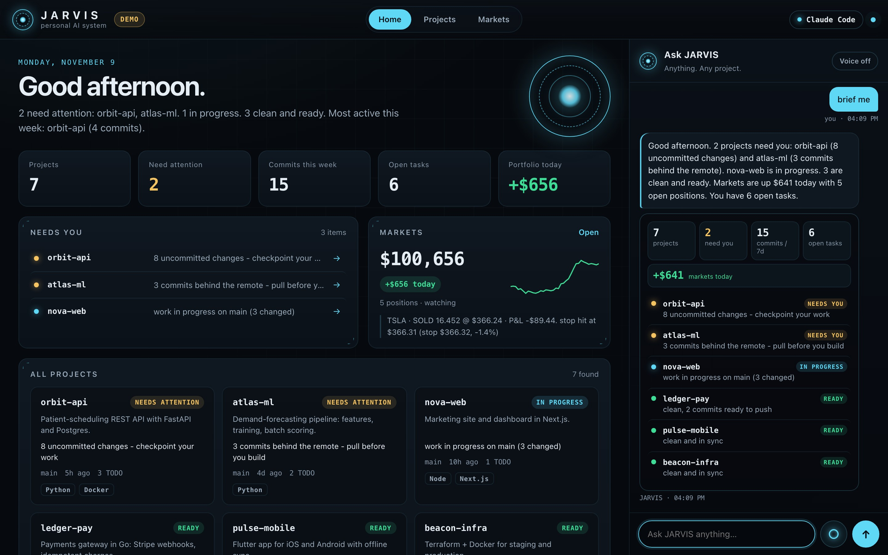
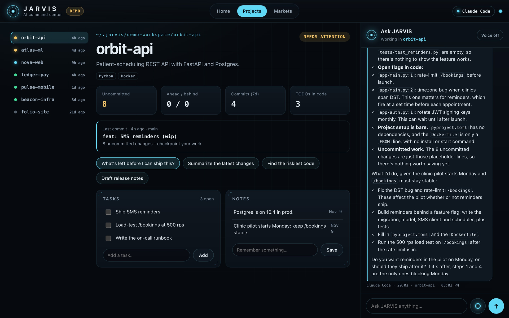
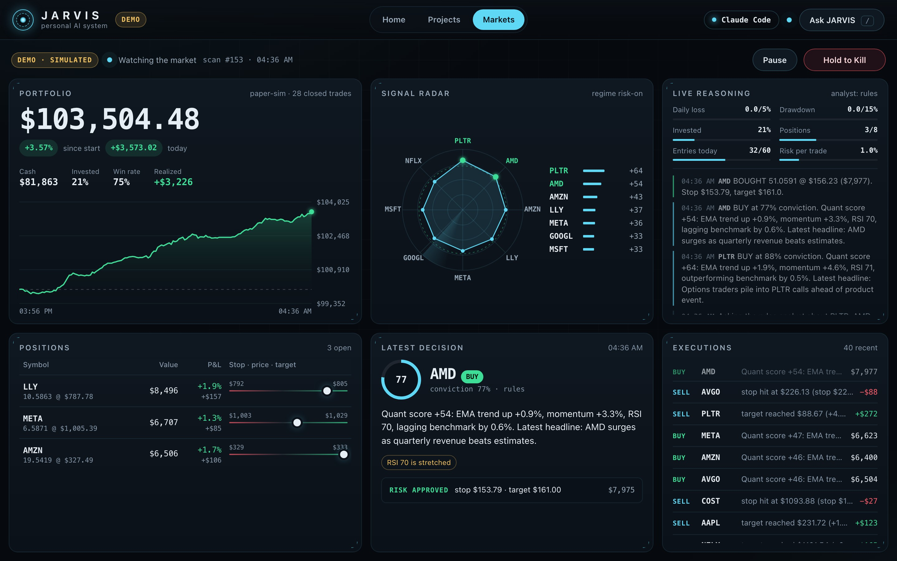
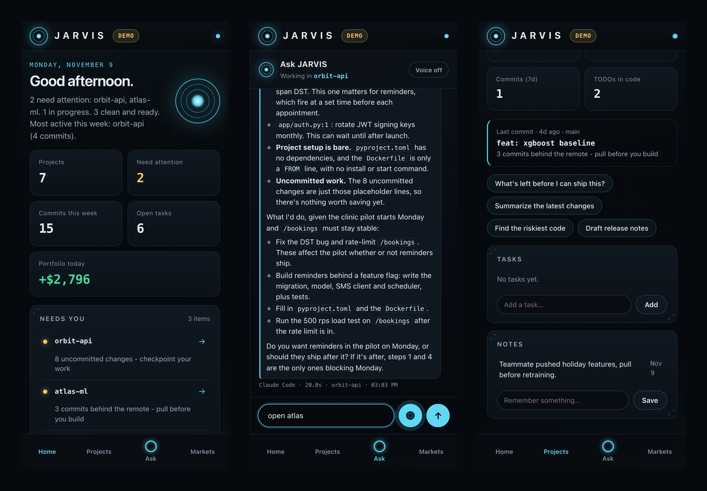

<div align="center">


# JARVIS · Your Personal AI System

**The assistant every developer has wanted since 2008. Now it's open source.**

One AI that knows all your work: every project you own, read with *any* model. It talks with you by voice, picks up when you call it, and runs a trading desk while you work.

Claude Code · Codex · Gemini CLI · Ollama · any CLI agent. Swap the brain with one line. Your code never leaves your machine.

[](https://github.com/begad-tamim/jarvis/actions/workflows/ci.yml)
[](https://github.com/begad-tamim/jarvis/actions/workflows/codeql.yml)


[](LICENSE)

[**Try it in 30 seconds**](#-try-it-in-30-seconds) · [What it does](#-what-jarvis-does) · [Any brain](#-any-brain-swap-it-in-one-line) · [On your phone](#-on-your-phone-voice-and-calls) · [Markets](#-markets-autonomous-trading-inside-hard-limits) · [Security](#-security) · [FAQ](#-faq)



<sub><code>jarvis demo</code>: a sample workspace of 7 real git repos plus a simulated market. No keys, no account, nothing leaves your machine.</sub>

</div>

---

## 🧠 The problem

You have nine projects, four terminals, three AI tools and one brain.

Every morning you re-explain your own work to a chatbot. You forget which repo has uncommitted changes, which one is behind, and what you promised to finish. Your AI lives in one tool on one laptop, so the moment you step away it can't help you. And the market moves while you're in a meeting.

## ⚡ The fix

**JARVIS** sits on top of the tools you already use and turns them into one assistant that knows your whole working life:

| | What you get |
|---|---|
| 🗂️ **Command center** | Every project on one screen, with live git status (dirty, ahead, behind, stale), TODO counts and a **daily briefing** computed from git. It costs zero tokens. |
| 💬 **Ask anything** | *"What's left before I can ship orbit-api?"* JARVIS runs your AI agent **inside that project's folder**, so answers come from the real code, not guesses. |
| 🔀 **Jump between projects** | *"Open atlas."* The context, notes, tasks and conversation follow you. |
| 🧠 **Any brain** | Claude Code, Codex, Gemini CLI, Ollama, the Claude API, or any command you like. Change one line and keep everything else. |
| 🎙️ **Voice** | Tap the mic and talk. JARVIS answers out loud. |
| 📱 **On your phone, anywhere** | Installs as an app on iPhone and Android. Laptop and phone share one live conversation. |
| ☎️ **It calls you, you call it** | *"Call me when the build is green."* Or dial JARVIS from any phone and talk to your workspace. (Twilio, optional) |
| 📝 **Memory** | *"Remember the pilot starts Monday."* Notes and tasks per project, always in context. |
| 📈 **Markets** | An autonomous trading desk on Alpaca: a quant engine and an AI analyst, with hard risk limits the AI can't override. |

> **The AI proposes. The code decides.** Brains run **read-only** by default. In trading, the model never picks a share count or skips a stop-loss.

## 👀 See it

| Home: your day in one screen | Ask: a real answer from the code | Markets: trading inside hard limits |
|---|---|---|
|  |  |  |

<p align="center"></p>

## 🚀 Try it in 30 seconds

```bash
git clone https://github.com/begad-tamim/jarvis
cd jarvis
pip install .            # zero dependencies: Python standard library only
jarvis demo              # sample workspace + simulated market + the HUD opens in your browser
```

Then let a real model answer about the sample code:

```bash
jarvis demo --brain auto     # uses Claude Code / Codex / Gemini, whichever you have installed
```

### Use it on your own projects

```bash
jarvis                       # finds the git repos in ~/projects, ~/code, ~/dev, ~/src
jarvis brief                 # the daily briefing, right in the terminal
jarvis ask "what changed in the API this week?" -p orbit-api
```

```toml
# jarvis.toml (optional)
[jarvis]
project_roots = ["~/work", "~/projects"]
brain = "auto"               # auto | claude-code | codex | gemini | ollama | claude | cmd | offline
allow_edits = false          # true lets the agent change files; default is read-only
```

## 🧠 Any brain: swap it in one line

JARVIS is the body. The model is swappable. Agent CLIs run **inside the active project**, so they read the actual files before answering.

| `brain =` | Runs | Read-only by default via | Needs |
|---|---|---|---|
| `claude-code` | `claude -p` | `--permission-mode plan`, edit and shell tools blocked | [Claude Code](https://claude.com/claude-code) |
| `codex` | `codex exec` | Codex's read-only sandbox | [Codex CLI](https://github.com/openai/codex) |
| `gemini` | `gemini -p` | headless mode (no tool approval) | [Gemini CLI](https://github.com/google-gemini/gemini-cli) |
| `ollama` | local `/api/chat` | no tools at all | [Ollama](https://ollama.com) |
| `claude` | Anthropic API | no tools at all | `pip install ".[ai]"` + `ANTHROPIC_API_KEY` |
| `cmd` | **anything**, e.g. `brain_command = "aider --message {prompt}"` | your choice | that tool |
| `offline` | no model | answers from git, TODOs and your tasks | nothing |

`auto` picks the first one installed. `jarvis brains` shows what's on your machine. Claude Code conversations resume per project, so follow-up questions keep their context.

## 📱 On your phone, voice and calls

**The HUD is a phone app.** Put JARVIS on your private network with [Tailscale](https://tailscale.com) (free), then open it on your phone and **Add to Home Screen**:

```bash
tailscale serve --bg 8777
echo 'JARVIS_ALLOWED_HOSTS=your-mac.your-tailnet.ts.net' >> .env
# open https://your-mac.your-tailnet.ts.net/#token=... on your phone (the link jarvis prints)
```

You get HTTPS, so the 🎙️ mic works on iOS and Android. Your laptop and phone show the same live conversation.

**Telegram** (free, no public URL): create a bot with @BotFather and set `TELEGRAM_BOT_TOKEN` + `TELEGRAM_CHAT_ID`. Only your chat id gets answers.
`/brief`, `/projects`, `/open orbit`, `/markets`, `/note …`, or just talk.

**Phone calls, both ways** (optional, [Twilio](https://www.twilio.com)):

```bash
# .env
TWILIO_ACCOUNT_SID=AC...   TWILIO_AUTH_TOKEN=...   TWILIO_FROM=+1555...   JARVIS_OWNER_PHONE=+1555...
JARVIS_PUBLIC_URL=https://your-mac.your-tailnet.ts.net    # e.g. `tailscale funnel 8777`
```

- **JARVIS calls you:** `jarvis call "deploy finished"`, say *"call me"*, or get a call automatically when the trading kill switch fires. It works in any script, too: `./deploy.sh || jarvis call "Prod deploy failed. Check the logs."`
- **You call JARVIS:** point your Twilio number's voice webhook at `$JARVIS_PUBLIC_URL/voice/incoming` and talk. Your speech goes to the same assistant, and the answer is read back to you.
- Every webhook must carry a valid **Twilio signature**, and **only your number** is answered.

## 📈 Markets: autonomous trading inside hard limits

The markets module trades US stocks on [Alpaca](https://alpaca.markets) (paper by default) and splits the job like a real desk:

| Role | Who | What it does |
|---|---|---|
| 📡 Quant | Python | Scores 20 liquid stocks on 7 explainable factors every few minutes |
| 🧠 Analyst | Claude / Claude Code / Ollama / rules | Reads signals and news, says *buy* or *pass* with a conviction and a thesis |
| 🛡️ Risk manager | Python | Sizes from volatility, attaches a stop, enforces 10+ hard limits. **Can veto anything.** |
| ⚙️ Execution | Alpaca | Bracket orders, so the stop lives **at the broker**, even if your laptop dies |
| 👁️ Oversight | You | The HUD, phone alerts, a call when it halts, and a hold-to-kill switch |

```bash
cp .env.example .env && chmod 600 .env     # free Alpaca paper keys
jarvis doctor                              # checks keys, config and security
jarvis                                     # command center + markets (on when keys exist)
jarvis trade                               # markets only
```

<details>
<summary><b>Guardrails</b> (the AI can't override any of these)</summary>

| Guardrail | Default | Why |
|---|---|---|
| Risk per trade | 1% of equity | Size = risk ÷ (2 × ATR). Volatile stocks get smaller positions. |
| Stop-loss | Mandatory, 2×ATR | Sent as a bracket order, so it lives at the broker |
| Take-profit / trailing | 4×ATR / 2.5×ATR | The trail ratchets up only |
| Max position / positions | 10% / 8 | No single-stock blowups |
| Margin | **Never** | Exposure capped at 95% of equity |
| Daily loss halt | -3% | Stops new entries for the day |
| Drawdown kill switch | -15% from peak | Cancels everything and flattens |
| Entries / cooldown | 20 per day / 60 min | No over-trading or revenge trades |
| PDT guard, liquidity, min conviction | on / $5 & $1M / 0.55 | Conviction can only *shrink* a position |
| **Live money** | **Locked** | Needs `mode = "live"` **and** `JARVIS_LIVE_TRADING=I_UNDERSTAND_THE_RISKS` |

</details>

<details>
<summary><b>Honest backtest</b></summary>

The backtester replays history through **the exact same engine that trades live**:

```bash
jarvis backtest NVDA AAPL MSFT AMZN META GOOGL AVGO JPM LLY COST --range 2y
```

| Daily bars, 10 mega-caps, 2 years to Nov 2026 | JARVIS | SPY buy & hold |
|---|---:|---:|
| Total return | **+8.9%** | +20.6% |
| Max drawdown | **-5.9%** | -19.0% |
| Trades / win rate / profit factor | 100 / 39% / 1.37 | 1 / n/a / n/a |

It lagged a strong bull market on return and took about a third of the drawdown. That's the price of risking 1% per trade. It's built to survive, not to promise 10x. The LLM analyst is left out of backtests to avoid look-ahead bias.

</details>

## 🔒 Security

JARVIS can see your code and your brokerage account, so it was built like it matters:

- **Local-first.** The HUD binds to `127.0.0.1`. Your code is only read by the brain *you* chose.
- **Read-only brains** by default (`allow_edits = false`). Git is read with plumbing commands only.
- **256-bit access key**, sent in a header (not a cookie, so no CSRF), a Host allow-list against DNS rebinding, a strict CSP, no third-party requests, and capped request bodies.
- **Signed phone webhooks** (Twilio HMAC) plus an owner-number check. **Allow-listed Telegram chats.**
- Workspace context is fenced as data, so a README or a headline can't instruct the model or place orders.
- Secrets only in `.env`, and `jarvis doctor` warns if it's readable by others. CI runs CodeQL and a 3-OS test matrix.

Details in [SECURITY.md](SECURITY.md).

## ⌨️ CLI

| Command | What it does |
|---|---|
| `jarvis` | Start JARVIS: HUD + assistant (+ markets, Telegram, phone when configured) |
| `jarvis demo [--brain auto]` | Sample workspace + simulated market. No keys. |
| `jarvis ask "…" [-p project] [--brain codex]` | Ask from the terminal |
| `jarvis brief` · `jarvis projects` · `jarvis brains` | Briefing, project status, installed brains |
| `jarvis call "…"` | JARVIS phones you |
| `jarvis trade` · `scan` · `backtest` · `status` · `kill` | The markets module |
| `jarvis doctor` | Config, keys and security checks |

In the HUD, press <kbd>/</kbd> to ask. Try *"brief me"*, *"open ledger"*, *"status of atlas"*, *"remember …"*, *"add task …"*, *"markets"*, *"pause trading"* or *"call me"*. Anything else goes to the brain.

## 🗂️ How it's built

```
jarvis/
├── assistant.py     # one conversation for every channel: HUD, phone, Telegram, calls
├── brains.py        # Claude Code · Codex · Gemini · Ollama · Claude API · any command · offline
├── projects.py      # discovery, live git status, the free daily briefing
├── channels/        # telegram.py (long polling), voice.py (Twilio calls, signed webhooks)
├── server.py        # the locked-down hub: token auth, CSP, SSE live sync
├── engine.py        # markets: scan → think → verify → execute → protect
├── strategy.py · risk.py · analyst.py · backtest.py · brokers/ · data/
└── web/             # the HUD: vanilla HTML/CSS/JS, installable as a phone app
```

Zero runtime dependencies. About 6,000 lines of Python and vanilla JS. 67 tests.

## ❓ FAQ

**Is it another chat UI?**
No. Chat UIs don't know your projects. JARVIS reads your repos' real state, runs your agent in the right folder, remembers per-project notes and tasks, and follows you to your phone.

**Do I need an API key?**
No. If you have Claude Code, Codex or Gemini CLI, JARVIS uses that. Ollama is free and local. With nothing installed, it still runs the free briefing and project tracking.

**Can it change my code?**
Only if you set `allow_edits = true`. Otherwise every brain runs read-only.

**Does the trading make money?**
Nobody can promise that. JARVIS gives you a disciplined, explainable, risk-capped process and an honest backtester. Paper-trade first. Not financial advice.

**Why "JARVIS"?**
Because everyone who writes code has wanted one. Now it's open source.

## 🗺️ Roadmap

- [ ] Wake word ("Hey JARVIS") in the phone app
- [ ] Calendar + email briefing (read-only)
- [ ] CI status per project (GitHub Actions)
- [ ] Hand off a task to an agent with `allow_edits` and review the diff in the HUD
- [ ] More brokers (IBKR, Tradier)

## 🤝 Contributing

PRs are welcome. See [CONTRIBUTING.md](CONTRIBUTING.md). Two rules: **zero required dependencies**, and **the AI never gets the final say on risk.**

**If JARVIS made you smile, a ⭐ helps other developers find it.**

## ⚠️ Disclaimer

For education and research. The markets module is **not financial advice**. Trading involves substantial risk of loss, and simulated results don't guarantee future results. You're responsible for any trades placed by software you run.

---

<div align="center">

Built by **Begad Tamim**, AI engineer · [GitHub](https://github.com/begad-tamim) · [LinkedIn](https://www.linkedin.com/in/begad-tamim) · MIT License

<sub>JARVIS AI assistant · personal AI system · open-source personal AI assistant · AI command center for developers · Claude Code UI · Codex CLI · Gemini CLI · Ollama · voice AI assistant · AI phone assistant · project manager for developers · daily standup briefing · AI trading bot · Alpaca trading bot · autonomous agent · lightweight · fast · zero dependencies</sub>

</div>
